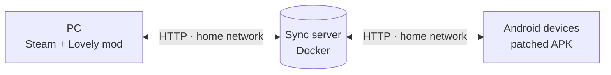

# Balatro Save Sync

Automatic, Steam-Cloud-style save sync between **Balatro on PC (Steam)** and the
**Android build made with [balatro-mobile-maker](https://github.com/blake502/balatro-mobile-maker)**,
through a tiny self-hosted server in your home network.

No cable, no ADB, no manual save transfers, and your PC mods are never touched.



> Unofficial fan project. Not affiliated with LocalThunk or Playstack. No game files
> are included: you need your own Steam copy of Balatro.

## How it behaves

| Situation | What happens |
|---|---|
| You start the game | Newer saves are pulled from the server *before* Balatro reads them. A short message bottom-left says what happened. |
| You play | Every change is uploaded within ~10 seconds, and once more when you quit or switch away from the app. |
| Tablet in the background while you play on PC | When you return to the tablet it notices the newer save and reloads itself. |
| PC game left open while you play on the tablet | The PC shows **"Newer save found"**. Click or press a key, start Balatro again, done. |
| Away from home | You play offline as usual; it syncs once the device is back on your home network. |
| A game is open but nobody plays | It never uploads, so it can't overwrite real progress from the other device. |
| A device syncs for the very first time | It adopts the state already on the server; its old saves are backed up locally. |

Conflicts (both devices played offline) are decided by **when you last actually
played** (last click/touch/key press), not by file times. Balatro rewrites its
saves on every start, so file times say nothing about real progress.

Safety nets:
- every local file that gets replaced is copied to `balatro_sync/backups/` in the save folder first (last 20 snapshots),
- the server keeps the last 50 versions of every file, with **Restore** buttons on its status page,
- Steam Cloud can stay on.

Synced files: profile slots `1`, `2`, `3` × `profile.jkr`, `meta.jkr`, `save.jkr`.
`settings.jkr` (window/graphics settings) is not synced by default.

## Repository layout

```
balatro-save-sync
├───android
│   ├───make_patched_exe.bat
│   └───make_patched_exe.py
├───pc-mod
│   └───BalatroSync
│       ├───balatro_sync.lua
│       ├───boot.lua
│       ├───config.lua
│       └───lovely.toml
├───server
│   ├───compose.yaml
│   └───server.py
├───tests
│   ├───love_e2e
│   │   ├───balatro_sync_config.lua
│   │   ├───conf.lua
│   │   └───game_main.lua
│   ├───love_e2e.py
│   ├───run_worker_test.sh
│   └───worker_test.lua
├───LICENSE
└───README.md
```

## Setup

### 1. Server

The server is a single Python file without dependencies.

1. Create a token:
   `python -c "import secrets; print(secrets.token_hex(16))"`
2. Create a stack/folder with `server/compose.yaml` and `server/server.py` next to each other.
3. In `compose.yaml`, replace `CHANGE_ME` with your token. Deploy.
4. Open `http://<server-ip>:8765/?token=<your token>`. You should see "No saves uploaded yet."

Without Docker: `SYNC_TOKEN=<token> SYNC_DATA_DIR=./data python3 server.py`.

### 2. Config

Edit `pc-mod/BalatroSync/config.lua`:

```lua
server_url = "http://192.168.x.y:8765",   -- your server's LAN IP, not a hostname
token = "<your token>",
```

This one file is used for the PC mod **and** the Android build.

### 3. PC mod

Needs [Lovely](https://github.com/ethangreen-dev/lovely-injector) 0.5 or newer
(older builds ship `version.dll`, newer ones `winmm.dll`). If you use Steamodded, you already have it.

Copy `pc-mod/BalatroSync` to `%AppData%\Balatro\Mods\`, so you get
`%AppData%\Balatro\Mods\BalatroSync\lovely.toml`. Steamodded is **not** required.

#### Vanilla by default, other mods only on demand

Sync only runs when Lovely is loaded. To keep the normal Steam launch vanilla
anyway, give each launch its own mods folder with Lovely's `--mod-dir` option:

1. Put the Lovely DLL into the Steam game folder (`steamapps\common\Balatro`).
2. `%AppData%\Balatro\Mods` contains **only** `BalatroSync` (plus Lovely's own `lovely` folder).
   The Steam launch is now vanilla + sync.
3. Move Steamodded and your other mods to a second folder, e.g. `C:\Users\<you>\AppData\Roaming\Balatro\ModsMP`.
4. A desktop shortcut for modded play gets `--mod-dir "C:\Users\<you>\AppData\Roaming\Balatro\ModsMP"`
   appended after the closing quote of the target (use the full path, not `%AppData%`).

To switch off a single mod without moving it, put an empty file named `.lovelyignore`
into its folder (Lovely 0.8+).

### 4. Android app

Needs Python 3 on the PC.

1. Run `android/make_patched_exe.bat`, or
   `python android/make_patched_exe.py --out "<balatro-mobile-maker folder>"`.
   It finds `Balatro.exe` in your Steam library, adds the sync code (device name "Tablet",
   change with `--device`) and writes the result as `Balatro.exe` into the balatro-mobile-maker
   folder. Your Steam install is not modified.
2. Run balatro-mobile-maker in that folder as usual, with the patches you normally use.
   **Answer "N" to both save transfer questions.** Sync does that now.
3. Let it install the APK, or copy `balatro.apk` to the device and install it as an update.
   It is signed with the same debug key as before, so it installs as an update and keeps your saves.
   If Android ever refuses because of a signature conflict, **do not uninstall**. That wipes the saves on the device.

More than one Android device (e.g. tablet and phone): repeat these steps per device with its own
name, e.g. `--device Phone`. Every device keeps its own sync state, so any number of devices works.

### 5. First sync

Start Balatro first on the device you played **last**. It uploads its saves.
Then start the other device: it adopts that state on start and backs up its own old saves.

## Security

The connection is plain HTTP with a shared token, intended for your **home network only**.
Don't expose port 8765 to the internet. To sync on the go, reach your home network through a
VPN such as Tailscale or WireGuard and use the server's VPN address in `config.lua`.

## Mods on PC, vanilla on Android

The Android build runs vanilla Balatro. When its progress syncs back, unlocks or discoveries
that only exist through PC content mods may get dropped. If that matters, play modded on its
own profile slot and leave that slot out of `profiles` in `config.lua` (e.g. `profiles = "1,2"`).

## Troubleshooting

**Message bottom-left after start:**
- "up to date", "loaded progress from …", "uploaded …": everything is fine.
- "server not reachable":
  - Is the device on the same network as the server? A phone hotspot or guest Wi-Fi is not.
  - Check the IP and port in `config.lua`.
  - With a VPN app on the device, LAN access must be allowed.
- "wrong token": `config.lua` and `compose.yaml` don't match. The Android build has the
  config built in, so rebuild it after changing the token.
- "not configured": `server_url` or `token` is empty.

**Logs:**
- PC: `%AppData%\Balatro\Mods\lovely\log\` contains a `[BalatroSync]` line for every upload/download.
- Server: one line per upload/delete/restore.

**Restore an old version:** open the status page, expand a file's history, click **Restore**.
It becomes the newest version. Devices pick it up on their next start; a running game shows the reload message.

**Start over on a device:** delete `balatro_sync/state.txt` in its save folder. On the next start
it adopts the server state again.

## Tested with

- Balatro 1.0.1o (Steam, Windows) with Lovely 0.9.0
- balatro-mobile-maker beta 0.8.3 on a Samsung Galaxy Tab S8+ and a Google Pixel 9
- Server on `python:3.12-alpine`, also checked with Python 3.15

iOS builds are not supported.

## License

MIT, see [LICENSE](LICENSE).
